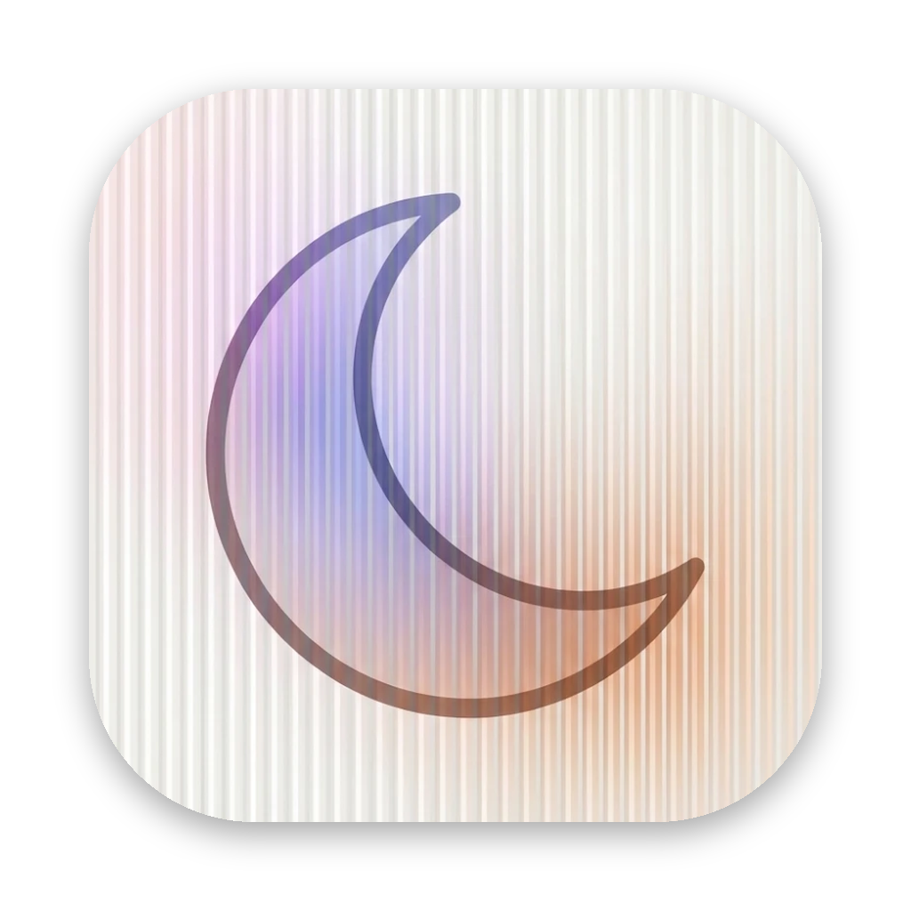

<p align="center"></p>

<h1 align="center">Crescent</h1>
<p align="center">A calm, fast, Arc-style browser for the Mac, built on Chromium.</p>

---

## Install

1. Open the latest [Release](../../releases) (or the **Crescent-dmg** artifact on the latest [Actions run](../../actions)).
2. Download `Crescent-…-arm64.dmg` for Apple Silicon (M1–M4), or `-x64.dmg` for an Intel Mac.
3. Drag **Crescent** into **Applications** and open it.

If macOS says it can't check Crescent for malware, go to **System Settings → Privacy & Security** and click **Open Anyway**. You only need to do this once. Builds signed with a Developer ID (see [Signing](#signing-and-notarizing)) skip this step.

**Updates install themselves.** When a new version is out, **Restart to update** appears at the bottom of the sidebar. One click and Crescent relaunches on the new version, with your tabs, spaces and logins untouched.

The first launch walks you through importing from another browser, creating your spaces, choosing how pins work, and setting Crescent as your default browser.

## What's in it

**Sidebar and tabs**
- **Vertical tabs.** New tabs go on top, and **↓ Clear** archives everything that isn't pinned.
- **Pinned bar.** An icon grid at the top of the sidebar for the sites you live in. It can be the same in every space or different per space; switching between the two never deletes a pin.
- **Pinned tabs with folders.** Closing a pinned tab only unloads it, and reopening it goes back to its pinned page. If you navigate away from the pinned page, a `/` marks the tab and a one-click button takes you back.
- **When you close everything**, Crescent lands on your most recent pinned tab.
- **⌃1–⌃8** jump to tabs and **⌃9** jumps to the last one. Pinned tabs and the pinned bar are skipped.

**Spaces**
- Each space has its own tabs, pins, icon and colours.
- Switch with a two-finger swipe on the sidebar, **⌃⌥1–9**, or **⌥⌘←/→**.
- An Arc-style colour picker sets up to three colours per space, with light/auto/dark mode and grain.

**Command bar (⌘T)**
- Searches Google suggestions, open tabs in every space, bookmarks and history.
- Type `>` for commands.
- **⌘↵** opens the result in split view, **⌥↵** in Peek, and **⇧↵** in Little Crescent.

**Ways to view pages**
- **Split view.** Up to four tabs side by side, with draggable dividers.
- **Peek.** Shift-click a link, or follow a link out of a pinned tab, to preview it without leaving the page.
- **Little Crescent.** Links from other apps open in a small window. One click moves the page into your main window.

**Library (⌘Y)** opens inside the sidebar, like Arc. It holds every closed tab (nothing is auto-archived), your history, your downloads and your snoozed tabs.

**New in 0.2**
- **Focus mode** (the target button, or ⇧⌘F):
  - Pick a length, the sites you're allowed and words like "math".
  - Crescent goes full screen. Searching still works, but anything else is blocked unless it's on your sites or the link contains one of your words.
  - The timer sits in the top right. Ending early means holding **Stop** for 5 seconds.
  - Sessions survive restarts.
- **Split view, upgraded:**
  - Drag a tab onto another tab to split them, up to four panes.
  - Right-click a split for Side by Side or Top and Bottom, Swap, Equal Sizes or Separate. Drag the divider to resize.
- **Private browsing, two ways:** a private window (⇧⌘N), or a private space (⇧⌘P) that you swipe to like any other space. Both use an in-memory session with no history or archive. A private space is wiped when you press **End** or quit.
- **Air Traffic Control:** rules like "links from Slack go to Work" or "figma.com goes to Design" (Settings → Air Traffic Control).
- **Full colour control per space:**
  - Up to three colours, picked on the colour field or typed as hex, each with its own tone.
  - Linear, radial or mesh gradients, with angle, intensity and grain.
  - Light, auto or dark mode.
- **Notes in the sidebar** (⌥⌘K): quick notes that sit next to your tabs. Lines starting `- [ ]` become checkboxes.
- **Media player:** music or video in another tab gets play/pause controls at the bottom of the sidebar. Videos float into picture-in-picture when you switch away.
- **Hover previews:** rest on a tab to see the page.
- **Snooze:** right-click a tab → Snooze, and it comes back later today, tomorrow, at the weekend or next week.
- **Calculator and conversions** in the command bar: type `2^10`, `10 km in miles` or `212 f to c`.
- **Small things:**
  - Duplicate-tab guard: typing a URL that's already open takes you to that tab.
  - Unread dots on background tabs.
  - Copy link as Markdown (⌥⌘C).
  - Press ⌘Q twice to quit.
  - Global Privacy Control.
  - A custom search engine.
- **Customize everything:**
  - Every keyboard shortcut can be remapped (Settings → Shortcuts).
  - Interface font and sidebar density.
  - Glass amount, page corners and spacing.
  - Number of columns in the pinned bar, and whether close buttons always show.
  - Animations on or off.
- **Easier editing:**
  - Click a space's name to rename it, or its icon to pick a new one (or type an emoji).
  - Drag a tab onto a space icon to move it there.
- **Settings** opens as a sheet inside the window (⌘,).

**Bookmarks** are one click away in the top bar (**⌥⌘B**).

**Import** comes from Arc (including spaces, pinned tabs, folders and the pinned bar), Chrome, Brave, Helium, Edge, Vivaldi, Opera, Dia, Zen (including workspaces), Firefox and Safari. It brings bookmarks, history, passwords, logins (cookies) and Chrome Web Store extensions.

**Chrome extensions**
- Install from the Chrome Web Store with "Add to Chrome".
- Extension buttons appear in the sidebar.

**Built-in ad and tracker blocking** uses AdGuard's filter lists. You can pause it per site.

**Passwords**
- Stored encrypted in your macOS Keychain.
- Autofilled on login forms.
- Crescent offers to save new ones.

**Downloads** ask where to save each file (you can switch this off in Settings).

**Privacy and memory**
- Sites must ask before using your camera, mic, location or notifications.
- Startup loads only the tab you're looking at.
- Tabs you haven't looked at for a while are unloaded to save memory. Tabs playing audio or using the camera are never unloaded.
- Crescent has no AI, no accounts and no telemetry.

## Keyboard shortcuts

| | |
|---|---|
| Command bar / new tab | ⌘T |
| Edit current URL | ⌘L |
| Close tab (pins stay) | ⌘W |
| Reopen closed tab | ⇧⌘T |
| Tab 1–8 / last tab | ⌃1–⌃8 / ⌃9 |
| Next / previous tab | ⌃⇥ / ⌃⇧⇥ |
| Next / previous space | ⌥⌘→ / ⌥⌘← |
| Space 1–9 | ⌃⌥1–⌃⌥9 |
| Pin / unpin tab | ⌘D |
| Add to pinned bar | ⇧⌘D |
| Split view | ⌃⇧= |
| Toggle sidebar | ⌘S |
| Copy URL | ⇧⌘C |
| Find | ⌘F |
| Bookmarks / bookmark page | ⌥⌘B / ⌥⌘D |
| Library / downloads | ⌘Y / ⇧⌘J |
| Edit theme | ⇧⌘E |
| New space | ⇧⌘S |
| Little Crescent / private window | ⌥⌘N / ⇧⌘N |
| Clear unpinned tabs | ⇧⌘⌫ |
| Focus mode | ⇧⌘F |
| New note | ⌥⌘K |
| Private space | ⇧⌘P |
| Snooze tab | ⌥⌘Z |

Every shortcut can be changed in **Settings → Shortcuts**.

## Known limits

- **Google sign-in:** Crescent signs in to Google by presenting itself as Firefox on Google's login page only. Other Chromium browsers like Min do the same. Everywhere else it reports itself as Chrome.
- **Netflix, Disney+ and other DRM video don't play yet.** They need Widevine, which plain Electron doesn't ship. The fix is to switch to castLabs' Electron build plus their free signing service; that's planned. YouTube, Twitch and other normal video work.
- **Touch ID passkeys** on websites aren't supported yet. Passwords and security keys work.
- **Extensions** that use rare Chrome APIs may only partly work. Most popular ones (ad blockers, dark mode, password managers, Better Canvas-style page tweaks) should work.
- **Firefox, Zen and Safari passwords** are encrypted in a way only those browsers can read. Export them to CSV from that browser, then use **Settings → Import → Import passwords from CSV**.

## Build from source

```bash
npm ci
npm start                       # run in development
npm test                        # unit tests
xvfb-run -a node test/e2e/run.js  # end-to-end tests (Linux; on a Mac just: node test/e2e/run.js)
npx electron-builder --mac      # build the .dmg (on a Mac)
```

The project is plain JavaScript with no bundler. Electron runs the main process in `src/main`, and the UI in `src/renderer` is Preact + htm loaded as ES modules. The rules for spaces, pins, folders and splits live in `src/main/model.js`, which has its own unit tests.

## Signing and notarizing

GitHub Actions builds the `.dmg` on every push. Without a certificate it ad-hoc signs the app, which runs fine but needs the one-time **Open Anyway** step above.

To ship a build that opens with no warning, add these repository secrets. They come from an Apple Developer account.

| Secret | What it is |
|---|---|
| `CSC_LINK` | Your **Developer ID Application** certificate exported as `.p12`, base64-encoded |
| `CSC_KEY_PASSWORD` | The `.p12` password |
| `APPLE_ID` | Your Apple ID email |
| `APPLE_APP_SPECIFIC_PASSWORD` | An app-specific password from appleid.apple.com |
| `APPLE_TEAM_ID` | Your 10-character Team ID |

Publishing a release:
- **Bumping `version` in `package.json` and pushing** publishes a release automatically. Every installed copy then offers **Restart to update**.
- You can also run **Actions → Build → Run workflow** with **Publish a GitHub Release** ticked, or push a tag such as `v0.2.0`.
